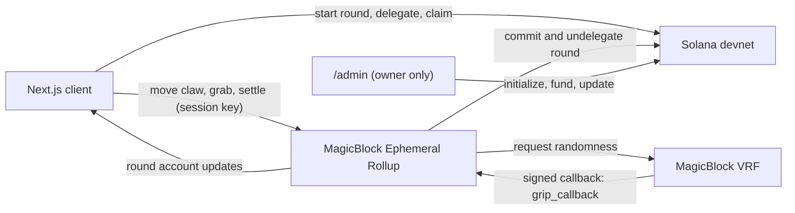

# CLAW

An onchain claw machine on Solana. You steer the claw, drop it on a prize, and a verifiable random roll decides whether the grip holds.

Every real claw machine is rigged. The operator sets how weak the claw is and nobody can check. Here the odds are a formula in the program, the roll comes from MagicBlock VRF, and every grab leaves a transaction anyone can open in the explorer.

Built for Solana Blitz v10, themed around Entertainment Finance, which requires a MagicBlock Ephemeral Rollup or VRF integration. CLAW uses both.

| | |
|---|---|
| Program ID | [`2gjcfh2Yp4iuD3TDPxtpRPY16L85nL9rQhoQM5YDYSLo`](https://explorer.solana.com/address/2gjcfh2Yp4iuD3TDPxtpRPY16L85nL9rQhoQM5YDYSLo?cluster=devnet) |
| Machine account | [`9TZ1GFSe...JBru`](https://explorer.solana.com/address/9TZ1GFSe2nxNM8i2Dpcd6nmiJkAAcQza2DWAJi55JBru?cluster=devnet) |
| Prize pool | [`HCCLJdbx...7AVo`](https://explorer.solana.com/address/HCCLJdbxQof5SXkWgeikS39jDSAu8zda7howeWQd7AVo?cluster=devnet) |
| Ephemeral Rollup | `https://devnet-as.magicblock.app` (validator `MAS1Dt9qreoRMQ14YQuhg8UTZMMzDdKhmkZMECCzk57`) |
| VRF queue | `5hBR571xnXppuCPveTrctfTU7tJLSN94nq7kv7FRK5Tc` (ephemeral) |
| Network | devnet |

## How a round works

1. Open the site. Without a wallet it runs as a free demo with local rolls.
2. Connect a wallet and press Play. One approval buys 3 grabs at 0.002 SOL each and moves your round onto the Ephemeral Rollup.
3. Steer the claw with the buttons on the machine, the arrow keys, or the touch pad. Moves stream to the rollup and need no wallet popups, because a session key the program registered for this round signs them.
4. Press Grab. The program checks which prize is under the claw, works out the grip chance from how well you aimed, and asks MagicBlock VRF for a roll.
5. The VRF callback lands on chain. If the roll is below the grip chance, the claw holds and the prize's SOL value is owed to you.
6. A grab on empty space, or on something out of reach, uses the credit and skips the roll.
7. When your grabs run out or you leave, the round is committed back to Solana and undelegated. Unused grabs are refunded.
8. Press Collect to receive what you won. Anything still owed is also paid the next time you press Play.
9. If VRF does not answer within 20 seconds, the grab can be retried on the same credit, or the round settled with that credit refunded. A late answer to an old request is ignored.

Everything is in integer lamports and SOL is the only asset. Many players can play at the same time: every wallet gets its own round account and they all share one prize pool.

## The odds

```
hold = max(floor, min(cap, price * payout_ratio * boost / value) * alignment)
alignment = 1 - 0.6 * (distance / reach)^2
```

Every prize has the same expected value per grab, so rarer prizes have a weaker grip. Aiming at the centre of a prize keeps the full chance, aiming at the edge loses up to 40 percent of it.

| Prize | Worth (grabs) | Grip chance, perfect aim, boost 2.5 |
|---|---:|---:|
| Legend collector box | 50 | 4% |
| SOL collector box | 10 | 20% |
| JUP and BONK collector boxes | 5 | 40% |
| Cut gem | 4 | 50% |
| Mystery capsule | 2 | 85% (capped) |
| Token coin | 1.5 | 85% (capped) |

| Setting | Value |
|---|---:|
| Price per grab | 0.002 SOL |
| Grabs per round | 3 |
| Payout ratio | 0.8 |
| Boost | 2.5 on devnet so wins show up in demos, 1 for real money |
| Grip cap | 85% |
| Grip floor | 3% |
| Reach | 80 mm from the prize centre |

At boost 1 the machine returns about 80 percent of what a well aimed grab costs on most prizes, the way an arcade machine does. The devnet boost is generous on purpose.

The program computes all of this itself in fixed point. The client never sends a grip chance or a result.

## Why MagicBlock

A claw machine needs the claw to move the moment you press a button. On Solana every nudge would be a transaction waiting to confirm, and a wallet popup for each one.

So each player's round is delegated to a MagicBlock Ephemeral Rollup. While the round is live, steering, the grab and the roll all run there, instantly and with no fees, and the result is committed back to Solana when the round ends.

The grip roll comes from MagicBlock VRF. The request is made from inside the grab instruction, the answer arrives through a callback only the VRF program can sign, and the callback is tied to one request by a nonce. Nobody, including the machine owner, can choose the outcome.

## Architecture



**Solana devnet** holds the program, the machine config and the prize pool. Players buy grabs, delegate their round and collect winnings here.

**Ephemeral Rollup** holds each player's round account while it is live. Claw moves, the grab, the VRF callback and settlement happen here.

**Frontend** is a Next.js app. It talks to both layers, subscribes to the round account on the rollup to see the roll the moment it lands, and links every step to the explorer. There is no backend and no database: all game state lives in two kinds of onchain account.

### What runs where

| Instruction | Runs on | Who signs |
|---|---|---|
| `initialize_machine`, `update_machine`, `withdraw_vault` | base layer | machine authority |
| `fund_vault` | base layer | anyone |
| `start_round`, `delegate_round` | base layer | player |
| `move_claw`, `grab`, `settle` | rollup | player or their session key |
| `grip_callback` | rollup | MagicBlock VRF only |
| `claim` | base layer | player |

## What keeps it fair

- The grip chance is computed on chain from the claw's onchain position, not reported by the client.
- The prize the client says it is grabbing must come with a Merkle proof against the pile root stored on the machine, so it cannot invent a prize or move one.
- Randomness comes from MagicBlock VRF. The callback requires the VRF program identity as signer and is bound to one request through a nonce, so stale or repeated callbacks do nothing.
- A grab can only be retried after the VRF timeout, and a retry spends the same credit, never a new one.
- The session key can move, grab and settle. It cannot withdraw, and payouts only ever go to the player's own wallet.
- Delegation is pinned to the validator stored on the machine.
- Only the authority wallet can change the machine config or withdraw from the prize pool.
- All maths is checked integer arithmetic. Unit tests pin the odds against the web formula and the Merkle proofs against vectors from the TypeScript client.

The program has not been audited. It is devnet only.

## Repo layout

```
apps/web/                 Next.js game client
  src/app/                routes: / (game), /admin (machine setup, owner only)
  src/features/cabinet/   the 3D machine: parts, materials, painted textures, prizes
  src/features/scene/     canvas, camera moves, lighting, post effects, win light show
  src/features/round/     claw state machine and the odds mirror
  src/features/chain/     onchain client: connections, PDAs, instructions, round session,
                          session key, pile Merkle tree, wallet UI, generated IDL
  src/features/audio/     synthesized arcade sounds
  src/features/play/      title, HUD, touch pad, result and prize screens
  src/stores/             Zustand stores
  src/proxy.ts            keeps /admin to the owner
programs/claw/            Anchor program
  src/instructions/       one file per instruction
  src/state/              Machine and Round accounts
  src/odds.rs             grip maths in fixed point
  src/merkle.rs           prize pile proofs
  src/vault.rs            prize pool transfers
packages/typescript-config/
migrations/
```

## Tech

| | |
|---|---|
| Program | Anchor 1.0.2, Rust 1.89, ephemeral-rollups-sdk 0.18 (`anchor`, `vrf`) |
| Client | Next.js 16, React 19, React Three Fiber, drei, postprocessing, Tailwind 4, Zustand 5, Motion |
| Chain | @solana/web3.js, @anchor-lang/core, Solana wallet adapter, @magicblock-labs/ephemeral-rollups-sdk |
| Tooling | pnpm workspaces, Turborepo, Biome |

## Running it

You need Node 22+, pnpm 10, Rust 1.89, Solana CLI 3.1 and Anchor 1.0.2.

### Game

```bash
pnpm install
pnpm dev
```

Open http://localhost:3000. It runs against the deployed devnet program with no `.env`. Without a wallet it plays in demo mode.

### Program tests

```bash
cargo test -p claw --lib
```

### Build and deploy your own

```bash
solana config set --url devnet
anchor keys sync
anchor build
solana program deploy target/deploy/claw.so \
  --program-id target/deploy/claw-keypair.json \
  --use-rpc --with-compute-unit-price 10000
```

Then open http://localhost:3000/admin with a devnet wallet, press **Initialize machine** and **Fund prize pool**. The wallet that initializes the machine becomes its authority. If you change the pile layout or odds in the web code, press **Update config from this build** so the program's pile root matches.

## Config

Everything has a devnet default. Override in `apps/web/.env.local`:

```dotenv
NEXT_PUBLIC_CLAW_PROGRAM_ID=2gjcfh2Yp4iuD3TDPxtpRPY16L85nL9rQhoQM5YDYSLo
NEXT_PUBLIC_SOLANA_RPC=https://api.devnet.solana.com
NEXT_PUBLIC_ER_RPC=https://devnet-as.magicblock.app/
NEXT_PUBLIC_ER_VALIDATOR=MAS1Dt9qreoRMQ14YQuhg8UTZMMzDdKhmkZMECCzk57
NEXT_PUBLIC_CLAW_CREDITS=3
NEXT_PUBLIC_CLAW_CHAIN=on        # "off" forces the local demo
ADMIN_PASSWORD=                  # unset: /admin only opens on localhost
```

If the public devnet RPC rate limits you, point `NEXT_PUBLIC_SOLANA_RPC` at a free Helius devnet endpoint.

Keypair files are local secrets and are gitignored. Do not commit them.

## Tests

| | |
|---|---|
| Rust unit tests | 11 |
| Type check | `pnpm check-types` |
| Lint | `pnpm lint` (Biome) |

The Rust tests cover the odds maths against the web formula, account sizes, and the Merkle root and proofs against vectors produced by the TypeScript client.

## Links

- [Ephemeral Rollups](https://docs.magicblock.gg/pages/ephemeral-rollups-ers/introduction/ephemeral-rollup)
- [VRF security](https://docs.magicblock.gg/pages/verifiable-randomness-functions-vrfs/introduction/security)
- [Ephemeral Rollups SDK](https://github.com/magicblock-labs/ephemeral-rollups-sdk)
- [MagicBlock VRF program](https://github.com/magicblock-labs/solana-vrf)
